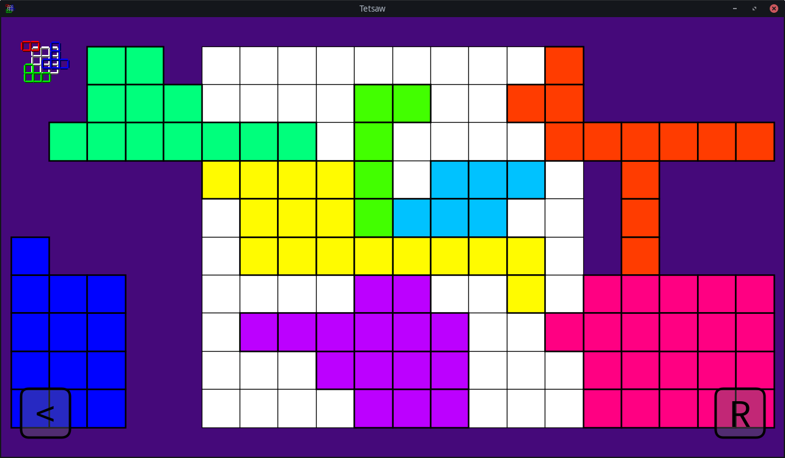
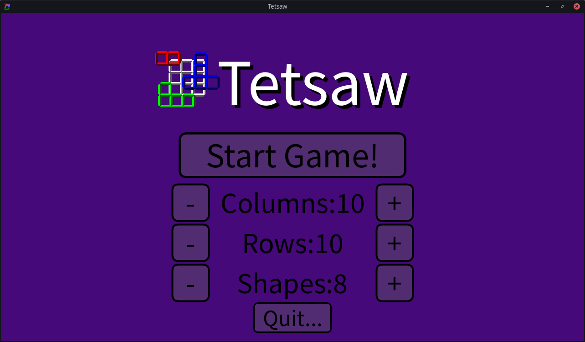

# Tetsaw

A small puzzle game for Linux, Android and Windows.

Fit the puzzle pieces into the grid, and win!

## [Click here to download!](../../releases/latest)

### Customisable game parameters!

### Demonstration of how puzzles get generated:

https://github.com/user-attachments/assets/de7cf3c4-5324-48d2-813d-a1051f72d1e4

## Contributing
Feel free to send small PRs to fix bugs or add small features.
For larger changes, please open an issue first to discuss what you would like to change.

You may use this project as a base for your own game, but please credit me and link back to this repository.
Make sure to also abide by the [license](LICENSE.txt).
